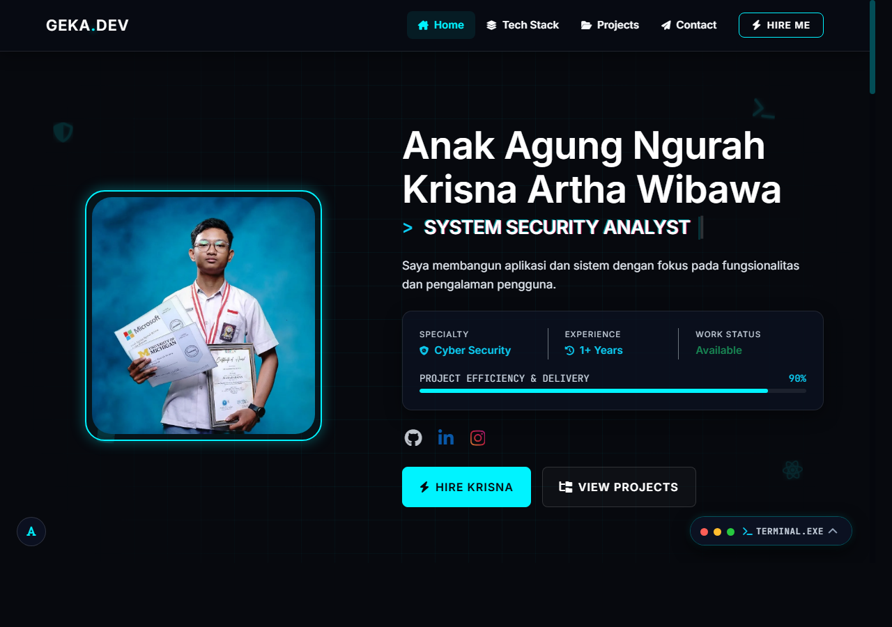

# Web Portfolio - Anak Agung Ngurah Krisna Artha Wibawa

Official personal developer portfolio website of Anak Agung Ngurah Krisna Artha Wibawa (GEKA.DEV), showcasing featured software engineering projects, technical competencies in cybersecurity and full-stack development, interactive application architecture overviews, and professional contact channels.

## Interface Preview



## Overview

This repository houses the source code for the high-performance, responsive portfolio platform engineered with a dark cybersecurity aesthetic. The application utilizes modern front-end web standards to present technical project case studies, interactive UI modals, live performance telemetry, and streamlined navigation across mobile, tablet, and desktop viewports.

## Core Capabilities and Architecture

- Dynamic Project Showcase: Data-driven project rendering powered by `projects-data.js` and `projects.js`, supporting asynchronous modal dialogs, multi-image carousels, feature breakdowns, and deep-dive technical specifications.
- Category Filtering Engine: Instant client-side filtering across diverse engineering domains including Web Development, Cybersecurity, and System Tools.
- Performance and Asset Optimization: Preloaded critical visual assets, WebP image compression, asynchronous non-blocking stylesheet loading, and minimal runtime dependencies.
- Cyberpunk & Modern UI/UX: Interactive typing terminal effect, glowing radar/sonar canvas animations, floating ambient tech iconography, and glassmorphism styling.
- Responsive Navigation: Bootstrap 5 flexbox grid layout integrated with custom CSS variables, sticky navigation bar, and accessible touch controls.

## Project Structure

```
Web-Portofolio/
├── assets/                  # High-resolution screenshots, mockups, and profile media
├── css/
│   ├── main.css             # Core layout, variables, typography, and animations
│   └── projects.css         # Styling for project cards, filters, and modal viewports
├── js/
│   ├── main.js              # DOM events, typing effect, scroll behavior, and observers
│   ├── projects.js          # Project rendering logic, modal controller, and filters
│   └── projects-data.js     # Structured dataset containing project metadata and case studies
├── img/                     # Iconography and brand imagery
├── index.html               # Main single-page application document
├── style.css                # Legacy fallback styling rules
└── README.md                # Repository documentation
```

## Technology Stack

- Front-End Markup: HTML5 (Semantic Structure)
- Styling & Layout: CSS3, Bootstrap 5.3.2, Custom CSS Variables
- Programming Language: Vanilla JavaScript (ES6+)
- Typography: Google Fonts (Inter, JetBrains Mono)
- Iconography: Font Awesome 6.5.1, Devicon 2.16.0

## Getting Started

### Prerequisites

A modern web browser supporting ECMAScript 6 (Chrome, Firefox, Edge, Safari). No compilation or package manager installation is required to run the client locally.

### Local Execution

1. Clone the repository:
   ```bash
   git clone https://github.com/ANTARTICA1/Web-Portofolio.git
   cd Web-Portofolio
   ```

2. Open `index.html` directly in your preferred browser, or serve it using a local HTTP server:
   ```bash
   # Using Python 3
   python -m http.server 8000

   # Or using Node.js http-server
   npx http-server . -p 8000
   ```

3. Navigate to `http://localhost:8000` in your web browser.

## Customization

To modify the featured projects or add new technical case studies:
1. Open `js/projects-data.js`.
2. Append or update objects within the `projectsData` array following the established schema (title, category, role, description, problem, solution, features, techStack, photos, and links).
3. Place corresponding screenshot assets inside the `assets/` directory.

## Author

Anak Agung Ngurah Krisna Artha Wibawa
- GitHub: [ANTARTICA1](https://github.com/ANTARTICA1)
- Portfolio: [GEKA.DEV](https://github.com/ANTARTICA1/Web-Portofolio)

## License

This project is open-source and available under the terms of the MIT License.

